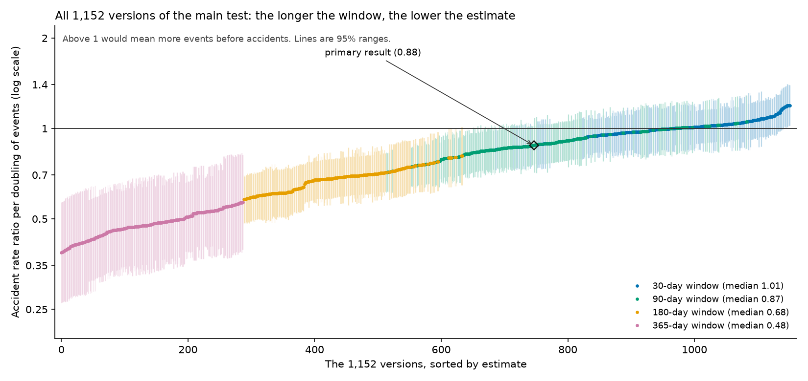

# Phase 5 results: secondary analyses

Phase 4 tested the main hypothesis and found no support for it: unplanned emission events do not rise in the 3 months before a serious accident at the same plant. Phase 5 reports the remaining registered analyses: the secondary versions of the main test, the robustness checks R1 to R30 and their variants, a negative-control test, the full set of 1,152 specification variants (the multiverse), between-plant and forward prediction tests, breakdowns, and replications with independent accident records. The rules used to run them, and every check added after results were seen, are listed in the analysis plan (deviations D9 to D12). Numbers come from `data/manifests/`.

## Summary

1. **No version of the test finds unplanned events rising in the months before an accident.** Several versions show the opposite (fewer events before accidents). This is an artifact of the design: an accident is itself reported to TCEQ, mostly on the day it happens, and those reports fall in the look-back windows of the comparison days that follow. When each plant's reports from the accident day and the 2 days after are removed from the counts, with every day kept, all results return to about 1 (main test 1.05, 95% range 0.85 to 1.29). Rises of more than about 30% in accident risk per doubling of recent events are unlikely (upper 95% limits of 1.26 to 1.33 across the versions of this check for the 90-day main test); smaller rises cannot be ruled out.
2. **Over the long run, plants have somewhat more accidents in the periods when they report more events.** Across a plant's whole history the association is 1.32 per doubling as registered and 1.24 (1.07 to 1.44) with the accident's own reports removed (plan D15). Within 5-year, 3-year and 2-year blocks and within the same year it is 1.11, 1.10, 1.07 and 1.05, none clearly above 1. Most of the fall seen in the registered versions (1.32 to 0.88) was the design trap; what remains is a modest long-run association and no short-term warning.
3. **Between plants, more events in one year go with somewhat more accidents the next year:** 1.12 per doubling (0.99 to 1.26) after adjusting for size, sector and prior accidents, and 1.15 (1.02 to 1.28) when regulators' inspections, violations and enforcement are added. Part of this is accident aftermath: leaving out the 0.9% of events reported in the month after an accident lowers it to 1.09 (p 0.15). Leaving out a month of events at a random time in the same years already lowers it to about 1.12, so the aftermath accounts for only part of the drop.
4. **Events add little to prediction.** A model fitted on 2004 to 2015 and tested on 2016 to 2021 ranks plant-quarters slightly better with events (area under the ROC curve 0.808 against 0.798) but flags the same share of accidents in its top 10%.
5. **The negative-control test is null** (1.00), so shocks shared by plants in the same county and sector do not drive the results.
6. **Independent accident records give consistent results.** National Response Center serious reports show the same pattern (1.08 once the accident's own reports are removed), and OSHA injury and fatality records show no clear association (1.10, 0.79 to 1.54).
7. **The 1,152 specification variants agree.** The window length drives the estimate (longer windows give lower estimates, from the aftermath effect). Only 0.9% of variants are significantly above 1, all from one narrow corner.
8. **Added checks agree** (section 11): a simulation shows the design trap can hide nearly all of a real 30% rise and that the correction recovers it; counting only events that release the plant's own RMP chemicals, or using satellite heat instead of company reports, also shows no clear rise before accidents.
9. **One exploratory lead, found after results were seen:** planned work (startups, shutdowns, maintenance) reported in the week before goes with a higher accident risk: 1.66 per doubling of planned-work reports, or about 1.6 times the risk when any planned work was reported (1.61, 1.08 to 2.39); shuffle test p 0.018. Unplanned events in the same week show nothing. The lead holds in most checks and is consistent with what is known about startup and shutdown risk, but it is weaker in 2006 to 2010 alone and rests on 32 accidents, mostly from years when such reports were common. The first fresh test, on National Response Center reports, was too weak to decide (1.37, 95% range 0.65 to 2.89, inconclusive), so it remains a lead.

## 1. Secondary versions of the main test (Holm correction over 15 tests)

Rate ratio of an accident per doubling of recent events (or as stated), study window ending 2021.

| Test | Result | 95% range | p after correction |
| --- | --- | --- | --- |
| Fires and explosions (O2) | 1.01 | 0.79 to 1.28 | 1.00 |
| Harm to people (O3) | 1.06 | 0.81 to 1.38 | 1.00 |
| Harm outside the fence (O4) | 0.56 | 0.39 to 0.81 | 0.02 |
| 30-day window | 0.95 | 0.83 to 1.08 | 1.00 |
| 180-day window | 0.68 | 0.59 to 0.80 | below 0.001 |
| 365-day window | 0.47 | 0.35 to 0.64 | below 0.001 |
| Events 0 to 3 months before | 0.86 | 0.72 to 1.04 | 0.81 |
| Events 3 to 6 months before | 0.71 | 0.59 to 0.86 | 0.005 |
| Events 6 to 12 months before | 0.67 | 0.52 to 0.86 | 0.02 |
| Events 12 to 24 months before | 0.72 | 0.52 to 0.99 | 0.39 |
| Top quarter of the plant's own counts (yes vs no) | 0.73 | 0.57 to 0.94 | 0.14 |
| Pounds released | 0.99 | 0.97 to 1.02 | 1.00 |
| Repeat events at the same emission point | 0.91 | 0.78 to 1.07 | 1.00 |
| Counted by report date (information available to a regulator at the time) | 0.86 | 0.74 to 1.01 | 0.55 |
| Process-control events vs outside or planned events | 1.10 (ratio of the two) | 0.82 to 1.46 | 1.00 |

None of these points toward a warning sign. The five significant results all point the other way; section 2 explains why.

## 2. Why some estimates fall below 1

An accident is itself reported to TCEQ, mostly on the day it happens: on the 541 accident days there were 212 unplanned event reports against 9.7 expected from each plant's long-run daily average, about 22 times as many (`data/manifests/stored_checks.json`). In this design each accident day is compared with the other days of the same plant-year, and the days after an accident carry those reports in their look-back windows. More events then appear on non-accident days, which pulls the estimate below 1. The longer the window, the more comparison days are affected, which matches the pattern above (30 days 0.95, 90 days 0.88, 180 days 0.68, 365 days 0.47).

The plan anticipated that these days would pull the estimate down. It described keeping them as "conservative", meaning they would pull a real rise toward 1; it did not anticipate estimates clearly below 1. The power simulation could not show the effect either, because its simulated accidents generate no reports. The review of the models (plan D10, addendum 2) identified the main source as the accident's own reports in its first days, rather than weeks of restart upsets.

**Removing the accident's own reports.** We removed each plant's event reports from the accident day and the 2 days after (269 of 68,610 events, 0.4%), kept every day, and reran the same test (`data/manifests/phase5_diag_own_reports.json`):

| Window | Reports removed: accident day only | Accident day and 2 days after | Accident day and 7 days after |
| --- | --- | --- | --- |
| 30 days | 1.01 | 1.02 (0.87 to 1.19) | 1.03 |
| 90 days (main test) | 1.03 | **1.05 (0.85 to 1.29)** | 1.08 |
| 180 days | 0.90 | 0.92 (0.73 to 1.16) | 0.98 |
| 365 days | 0.94 | 0.98 (0.75 to 1.26) | 1.03 |

With the accident day and the 2 days after removed, harm outside the fence gives 0.74 (0.51 to 1.07), and the four lag bins (0 to 3, 3 to 6, 6 to 12 and 12 to 24 months before) give 1.12, 0.97, 0.99 and 0.96, none significant. The same removal around simulated accident dates (60 draws) gives a median of 1.03 for 90 days and 1.01 for 365 days, so the removal itself shifts the estimate by at most a few percent.

This is our best estimate of the main result: no evidence of a rise before accidents, and rises of more than about 30% per doubling of events are unlikely (upper limits of 1.26 to 1.33 across the windows and removal choices, and in the National Response Center version below). The registered primary's upper limit (1.02) understates the uncertainty, because the accident's own reports pull that estimate down.

Other checks point the same way:

- With simulated accident dates (which generate no reports; 30 draws), the 90, 180 and 365-day versions give medians of 0.99, 0.99 and 0.96, so the code does not produce the effect (`data/manifests/stored_checks.json`).
- Dropping the days after accidents, instead of removing the reports, also brings results to about 1: primary 1.13 (p 0.36), harm outside the fence 0.83 (p 0.43), 180 days 1.08 (p 0.64), top quarter 1.24 (p 0.32), registered check R16 1.15 (p 0.30). Dropping days is known to push estimates up when a real effect exists (in the power simulation a planted 1.3 came out 1.39), so the removal version above is preferred.
- R27 (an indicator for an accident in the past year) gives 1.01, but it is not independent support: the indicator is 1 on almost every comparison day after an accident and almost never on an accident day, so it acts like dropping those days.
- A first version of the removal (`src/phase5_diag_clean.py`) removed reports from the days after accidents but kept the accident day. Its estimates rose steadily with the number of days removed, past 1.25. That is a bias of the method itself, since it lowers counts only on non-accident days. It was stopped and its results are not used.

## 3. Robustness checks R1 to R30

The primary result is 0.88 (0.75 to 1.02). Each check changes one element of the design.

| Check | Result | 95% range |
| --- | --- | --- |
| Gap of 0 / 1 / 30 days (R2) | 0.93 / 0.91 / 0.84 | 0.80 to 1.08 / 0.78 to 1.06 / 0.72 to 0.98 |
| Plus opacity events / all event types (R3) | 0.87 / 0.87 | 0.75 to 1.02 / 0.74 to 1.00 |
| Counted by report date (R4) | 0.86 | 0.74 to 1.01 |
| Storm periods removed, NOAA (R5) | 0.83 | 0.70 to 0.99 |
| Regional instead of statewide count (R6) | 0.88 | 0.76 to 1.03 |
| One-to-one plant links only (R7) | 0.79 | 0.66 to 0.94 |
| Window ending 2022 / 2023 / 2025 (R8) | 0.87 / 0.87 / 0.85 | 0.75 to 1.01 / 0.75 to 1.01 / 0.74 to 0.99 |
| Ending 2025, weighted for late filing (R8b) | 0.83 | 0.72 to 0.96 |
| Accidents within 3 days merged (R9) | 0.88 | 0.75 to 1.03 |
| Each plant left out in turn (R10) | 0.86 to 0.90 | range of 216 fits |
| Conditional logistic, any accident (R11) | 0.87 | 0.75 to 1.02 |
| Negative binomial (R11) | 0.88 | 0.75 to 1.02 |
| Strata by plant across all years (R12) | **1.32** | **1.14 to 1.53** |
| Every report counted (R13) | 0.87 | 0.75 to 1.01 |
| One effect per calendar month (R14) | 0.87 | 0.74 to 1.02 |
| Accident chains dropped (R15) | 0.82 | 0.67 to 1.00 |
| Days after accidents dropped (R16) | 1.15 | 0.88 to 1.50 |
| Non-reportable and filed-in-error reports dropped (R17 / R17 extended) | 0.86 / 0.87 | 0.74 to 1.01 / 0.74 to 1.02 |
| Original accident dates (R18) | 0.88 | 0.76 to 1.03 |
| No duplicate merges (R19) | 0.87 | 0.75 to 1.02 |
| Original registry-only plant links (R20) | 1.00 | 0.81 to 1.24 |
| Reporting-rule periods 2003 to 2005 / 2006 to 2014 / 2015 to 2021 (R21) | 0.66 / 0.98 / 0.88 | test of difference p 0.10 |
| FEMA disaster periods removed (R22) | 0.84 | 0.68 to 1.02 |
| Hurricane and tropical storm passages removed (R23) | 0.88 | 0.75 to 1.02 |
| 2020 COVID months removed (R24) | 0.87 | 0.75 to 1.02 |
| Freeze, lightning and wind controls (R25) | 0.87 | 0.74 to 1.02 |
| Refinery utilization and industry output controls (R26) | 0.88 | 0.76 to 1.03 |
| Accident in the past year added (R27) | 1.01 | 0.65 to 1.58 |
| Days after an ownership change removed (R28) | 0.88 | 0.74 to 1.04 |
| TCEQ's own coordinates (R29) | not run | request withdrawn; see section 10 |
| Merged occurrences (R30) | 0.88 | 0.76 to 1.03 |

Only R12 is significantly above 1; section 4 explains it. The window-length checks (R1) are in section 1.

## 4. The long-run association (R12)

R12 compares each plant with itself across all its years instead of within one year, and finds 1.32 (1.14 to 1.53). Narrowing the comparison step by step shows where this comes from:

| Days compared with | Result | 95% range |
| --- | --- | --- |
| The plant's whole history (R12) | 1.32 | 1.14 to 1.53 |
| Same plant, same 5-year block | 1.13 | 0.98 to 1.31 |
| Same plant, same 3-year block | 1.09 | 0.93 to 1.27 |
| Same plant, same 2-year block | 1.00 | 0.85 to 1.17 |
| Same plant, same year (primary) | 0.88 | 0.75 to 1.02 |

Plants tend to have more accidents in the periods when they report more events, but within any span of about two years the timing of events shows no detectable association with when an accident occurs.

**Rerun with the accident's own reports removed (plan D15, `data/manifests/phase5_diag_era_own_removed.json`).** Narrower strata put a larger share of post-accident days among the comparisons, so the trap of section 2 could produce part of this fall. With each plant's reports from the accident day and the 2 days after removed, every day kept:

| Days compared with | As registered | Own reports removed |
| --- | --- | --- |
| The plant's whole history (R12) | 1.32 (1.14 to 1.53) | 1.24 (1.07 to 1.44) |
| Same plant, same 5-year block | 1.13 (0.98 to 1.31) | 1.11 (0.93 to 1.33) |
| Same plant, same 3-year block | 1.09 (0.93 to 1.27) | 1.10 (0.91 to 1.32) |
| Same plant, same 2-year block | 1.00 (0.85 to 1.17) | 1.07 (0.87 to 1.31) |
| Same plant, same year (primary) | 0.88 (0.75 to 1.02) | 1.05 (0.85 to 1.29) |

Most of the registered fall was the trap. A modest association remains across a plant's whole history (the only version clearly above 1); within a few years none is detectable. The association is between longer periods, not a short-term warning.

## 5. Between plants (H2) and prediction (H3)

**H2** relates accidents in a year to unplanned events in the previous year, for 1,065 plants (15,506 plant-years, 525 accidents), adjusted for staff, largest chemical quantity, number of processes, emissions (EPA National Emissions Inventory), sector, accidents in the past 5 years and year.

| Model | Result per doubling | 95% range | p |
| --- | --- | --- | --- |
| H2 | 1.12 | 0.99 to 1.26 | 0.08 |
| H2b (plus inspections, violations, enforcement) | 1.15 | 1.02 to 1.28 | 0.02 |
| Added check: H2b plus accidents in the previous year | 1.13 | 1.01 to 1.27 | 0.03 |
| Added check: H2b without events in the 30 days after an accident | 1.09 | 0.97 to 1.22 | 0.15 |

In the same model, accidents in the past 5 years are by far the strongest predictor (2.34 per doubling), followed by staff size (1.23). Inspections, violations and enforcement show no clear association with accidents. Treating a staff count of 0 as missing or keeping it makes no difference.

**H3** fits the model on 2004 to 2015 and tests it unchanged on 2016 to 2021 (135 accident quarters among 20,214 plant-quarters).

| Measure | Without events | With events |
| --- | --- | --- |
| Area under the ROC curve | 0.798 (0.748 to 0.843) | 0.808 (0.761 to 0.851) |
| Gain from adding events | | 0.010 (0.003 to 0.018) |
| Accident quarters in the top 10% flagged | 53% | 52% |
| Calibration slope (1 is ideal) | 0.97 | 0.98 |

Testing on 2016 to 2023 gives the same picture (gain 0.009).

**Natural frequencies** (per 1,000 plant-quarters, 2004 to 2021; not adjusted for plant size, so they largely reflect that large plants have more of both):

| Flag | Accident quarters per 1,000 flagged | Per 1,000 not flagged | Share of accident quarters flagged | False alarms per true alarm |
| --- | --- | --- | --- | --- |
| At least 1 event in the prior 90 days | 25.6 | 5.0 | 42% | 38 |
| At least 3 events | 37.8 | 6.0 | 25% | 25 |
| At least 10 events | 46.0 | 7.2 | 5% | 21 |
| Top 10% of the prediction model (partly the years it was fitted on) | 41.3 | 3.8 | 55% | 23 |

Across all linked plants, the accident rate is 33 per 1,000 plant-years.

## 6. All specification variants (multiverse)

The plan required the main test to be run over every combination of reasonable choices: end of the study window (2021, 2022, 2023, 2025), gap before the accident (0, 1, 7, 30 days), window length (30, 90, 180, 365 days), event types counted (unplanned; plus opacity; all types), plant linking (registry only; full; one-to-one) and whether duplicate accidents are merged. That gives 1,152 variants, all of which were fitted.

| Choice | Median result | Share above 1 | Significantly above 1 | Significantly below 1 |
| --- | --- | --- | --- | --- |
| All 1,152 variants | 0.76 | 16% | 0.9% | 58% |
| 30-day window | 1.01 | 53% | 3.5% | 0.7% |
| 90-day window | 0.87 | 10% | 0% | 33% |
| 180-day window | 0.68 | 0% | 0% | 99% |
| 365-day window | 0.48 | 0% | 0% | 100% |
| Linking: registry only / full / one-to-one | 0.82 / 0.75 / 0.68 | 27% / 13% / 8% | 2.6% / 0% / 0% | 50% / 59% / 65% |
| Events: unplanned / plus opacity / all types | 0.77 / 0.76 / 0.71 | 17% / 17% / 14% | 0% / 0% / 2.6% | 58% / 58% / 58% |
| Window ends 2021 / 2022 / 2023 / 2025 | 0.76 / 0.76 / 0.75 / 0.74 | | | |
| Duplicates merged / not merged | 0.76 / 0.76 | | | |

Full table: `data/manifests/phase5_multiverse.csv`; summary: `docs/figures/multiverse_summary.csv`.

Window length drives almost all of the variation: the longer the window, the lower the estimate (1.01, 0.87, 0.68, 0.48), as expected from the aftermath effect in section 2. The other choices barely move the estimate; the end of the window and the merging of duplicates make no difference. The primary result (0.88) sits in the middle of the 90-day variants.

Only 10 of the 1,152 variants (0.9%) are significantly above 1. (The variants are highly dependent on each other, so this share cannot be compared with a simple chance rate.) Because merging duplicates makes no difference with registry-only links, these are 5 distinct variants, all in one corner: a 30-day window ending the day before the accident (or two days before), all event types, registry-only links (1.18 to 1.19). A 7-day gap removes them, which pointed to something in the last week before accidents. Section 7 follows this up.

## 7. Exploratory: planned work in the week before an accident

This analysis was not in the registered plan; it was prompted by the multiverse results and is reported as exploratory, a lead to be tested on new data.

The positive corner of the multiverse comes from one kind of report: planned work, that is, the maintenance, startup and shutdown reports plants file with TCEQ. Unplanned emission events in the same week show nothing.

| Reports starting in the 7 days before | Result per doubling | 95% range | p |
| --- | --- | --- | --- |
| Planned work (maintenance, startup, shutdown) | 1.66 | 1.27 to 2.19 | 0.0003 (model); 0.018 (shuffle test, below) |
| Unplanned events (emission events, opacity) | 1.02 | 0.79 to 1.31 | 0.90 |

Window ending 2021, full linking; both counts and their statewide totals in one model, otherwise the same design as the primary test. Ending in 2023 gives the same result (1.67).

Of the 541 accident days, 32 (5.9%) had planned work reported at the same plant in the preceding week, compared with 3.6% of all days in the comparison. These 32 accidents occurred at 17 plants.

Checks for alternative explanations:

| Check | Planned-work result |
| --- | --- |
| Startups only / shutdowns only / maintenance only | 2.00 / 1.60 / 1.08 |
| Days 1 to 3 before / days 4 to 7 before | 1.71 / 1.61 |
| Day before skipped (days 2 to 8) | 1.70 |
| Only work notified to TCEQ before it started (so it cannot be a report of the accident) | 1.68 (p 0.001) |
| Work finished before the accident day / still in progress | 1.58 / 1.78 |
| Storm days removed (NOAA storm records / FEMA disasters / hurricane tracks / all three) | 1.63 / 1.77 / 1.63 / 1.80 |
| Accidents within 120 days after an earlier accident removed (restarts after an accident) | 1.66 |
| All days within 120 days after an accident removed | 1.78 |
| Each plant left out in turn | 1.59 to 1.73 (all p below 0.004) |
| Simulated accident dates, 200 draws (expected about 1) | median 0.97; 6.5% significant; none as high as 1.66 |

**Permutation test.** The model's p-value (0.0003) is too optimistic. When the dates of planned work are shuffled within each plant-year with accidents held fixed (500 shuffles, `data/manifests/phase5_diag_planned_perm.json`), the estimates spread about 1.3 times wider than the model assumes. Against that distribution the observed value (1.68 when the 7-day counts are built within each plant-year, as the shuffle requires) gives p = 0.018 two-sided (0.004 one-sided). A second, separately written shuffle test gave 0.017. Further checks (`data/manifests/phase5_diag_planned_extra.json`):

| Check | Result |
| --- | --- |
| Planned work in the week before, yes or no | 1.61 (1.08 to 2.39), p 0.02 |
| The two plants with the most cases (15 of the 32) left out | 1.71 (p 0.015) |
| Each calendar year left out in turn | 1.57 to 1.77 (rebuilt in `src/phase5_diag_planned_extra.py`, plan D16) |
| 2006 to 2010 only | 1.33, not significant |

**Decline in planned-work reports.** Planned-work reports at linked plants fell from 1,000 to 1,400 a year (2003 to 2009) to 65 to 110 a year (2023 to 2025; counts by year in `data/manifests/stored_checks.json`), so the finding rests mostly on the earlier years. The reason for the decline has not been established; one possibility is that planned emissions came to be authorized in permits and no longer required a report.

**Contributing factors in the RMP accident records.** RMP has no field for the operating state of the unit, so this evidence is indirect. Plants mark contributing factors for each accident. The 32 accidents with planned work in the week before, compared with the other 513 (`data/manifests/phase5_diag_planned_rmp.json`):

| Factor marked by the plant | After planned work (32) | Other accidents (513) |
| --- | --- | --- |
| Initiated by human error | 53% | 32% |
| Improper procedure | 41% | 23% |
| Maintenance | 34% | 20% |
| Management error | 19% | 5% |
| Equipment failure | 41% | 45% |

This is the pattern expected from non-routine work: more procedural, human and management factors, and no more equipment failure. With 32 accidents and 14 factors compared, none of the differences survives a correction for multiple comparisons, so this is consistent with the finding but does not establish it.

**Interpretation.**

- This is not the warning sign the study looked for. Unplanned events do not rise before accidents, and planned work does not accumulate either; it marks a few days when a unit is being started up, shut down or worked on.
- It is consistent with existing process safety knowledge, although the figures usually quoted rest on thinner evidence than they suggest. The Chemical Safety Board's 2018 Safety Digest on startups and shutdowns ([CSB Safety Digest](https://www.csb.gov/assets/1/6/csb_digest_-_startup_shutdown.pdf)) states that process safety incidents occur five times more often during startup than in normal operation. Its source, the Center for Chemical Process Safety (CCPS 1995, p. 113), cites an insurer's compilation of large property losses (Marsh & McLennan, 1992), and elsewhere in the same book (p. 245) describes that source as finding catastrophic accidents five times more likely in any non-normal operation, startups and shutdowns together. The insurer's compilation itself could not be found. The Digest's figure that half of incidents occur in such operations comes from a 2010 industry article (Ostrowski and Keim, "Tame Your Transient Operations", Chemical Processing), which cites Duguid's 1998 analysis of about 500 incidents (IChemE Loss Prevention Bulletin). Duguid's later analysis of 1,000 major incidents in the process industries (Hazards XX, 2008) coded 45% as occurring when the plant was not in normal operation. The point estimates here, highest for startups and lowest for routine maintenance, fit this literature, although their intervals overlap (startups 2.00, 1.14 to 3.51; maintenance 1.08, 0.72 to 1.62).
- What may be new is that public regulator records show it. We found no published study that uses regulator records of planned work to measure accident risk. Most of these reports (80%) were filed before the work started. Such reports have declined steeply since about 2010, however, so today they would flag far fewer risky periods than they once did.
- An alternative reading is that a unit that starts misbehaving is shut down for planned work and the accident follows on restart. In that case planned work marks a unit already in trouble rather than being risky in itself. These data cannot separate the two; either way, the days after planned work carry more risk.
- Limits: the lead was found after examining 1,152 variants and then splitting the result. It rests on 32 accidents at 17 plants, mostly from years when planned-work reports were common. The registered 90-day all-types check (R3) did not show it, because a 90-day window dilutes the few risky days among many ordinary ones. The fresh tests are specified in advance in `docs/planned_work_test.md`. A test on accidents after 2025 alone would have too little power, since planned-work reports have nearly stopped.

## 8. Other results

- **Negative control (N1):** accidents at other plants in the same county and sector, against this plant's events: 1.00 (0.96 to 1.04).
- **Accidents also reported to TCEQ:** 43% of RMP accidents have a TCEQ report at the same plant within 2 days (49% in 2003 to 2005, 41% in 2006 to 2014, 43% in 2015 to 2021).
- **By sector** (estimates only, no claims): refining 1.19 (0.87 to 1.65, 22 plants), chemicals 0.83 (0.67 to 1.03), gas processing 1.16 (0.81 to 1.64), other 0.38 (0.21 to 0.69).
- **By region** (estimates only): Houston 0.94, Beaumont 0.63, Corpus Christi 0.86, other regions 0.80.
- **By cause and by unit type:** no category stands out; every interval includes 1. The cause rules agree with the author's blind hand coding of 400 random events on the primary cause 72% of the time (Cohen's kappa 0.67) and on the three groups of the process-control contrast 83% of the time (kappa 0.70); the rules rarely assign operator or procedure causes (`data/manifests/cause_agreement.json`).

## 9. Independent accident records (H4, O6) and the first fresh test of the planned-work lead (T3)

These analyses use the author's hand review of record links, done blind to all event and accident data (names, addresses and dates only): 262 serious National Response Center reports at 114 TCEQ sites, and 320 OSHA records at 104 RMP plants. Answers of "can't tell" were treated as no link. The rules were added to the plan (D11) before any of these analyses was run. Results: `data/manifests/phase5_h4_o6.json`, `t3_planned_nrc.json`, `completeness_check.json`.

| Test (rate ratio per doubling of events, 90-day window) | As registered | Accident's own reports removed (section 2) |
| --- | --- | --- |
| **H4: National Response Center serious reports** (218 report days, 105 sites, to 2021) | 0.82 (0.66 to 1.01) | **1.08 (0.88 to 1.33)** |
| H4 to 2023 (238 report days, 112 sites) | 0.79 (0.65 to 0.96) | 1.04 (0.86 to 1.26) |
| **O6: OSHA fatalities, catastrophes and severe injuries** (2015 to 2021, 210 plant-days, 81 plants) | 1.10 (0.79 to 1.54) | 1.13 (0.80 to 1.60) |
| O6 to 2023 (255 plant-days, 91 plants) | 1.08 (0.82 to 1.44) | 1.12 (0.83 to 1.50) |

The main result is consistent in a separate accident record. Most of the National Response Center sites are in RMP-linked plants (91 of 105 sites, 193 of 218 report days), but most of its events are not RMP accidents (only 33 of 218 report days fall within 3 days of one; `data/manifests/h4_overlap.json`, plan D16). It shows the same two features as RMP: the registered version falls below 1, and removing the accident's own reports brings it to about 1. OSHA injury and fatality records, mostly not chemical releases, show no clear association either (the intervals are wide).

**Fresh test T3 of the planned-work lead**, as specified in advance (`docs/planned_work_test.md`): National Response Center report days with no RMP accident at the same plant within 3 days (205 days, 104 sites). Only 12 of these had planned work reported in the preceding week. The power check, run first, showed that a true effect of 1.5 would be confirmed only 30% of the time. Result: 1.37 (0.65 to 2.89), inconclusive and underpowered; the range is too wide to confirm or rule out the lead. With all linked reports the result is 1.24 (0.62 to 2.49). The lead remains a lead; the next fresh test is another state (T2).

**Completeness of RMP.** Serious events at RMP-linked plants, and how many also appear as an RMP accident at the same plant within 3 days (June 2003 to 2023):

| Source | Plant-days | With an RMP accident within 3 days |
| --- | --- | --- |
| National Response Center serious reports | 212 (94 plants) | 35 (17%) |
| of which a chemical on the RMP list was named | 74 | 14 (19%) |
| OSHA fatality or catastrophe investigations | 63 (50 plants) | 5 (8%) |
| OSHA severe injury reports (2015 on) | 255 (95 plants) | 9 (4%) |
| News incidents (random sample of 500 news links, checked by hand; 39 distinct incidents) | 25 at RMP facilities | 9 (36%), all on the same day |

Most of these serious events have no RMP record. This is an upper bound on what RMP misses, not a count, for three reasons: RMP covers only releases of listed chemicals from covered processes with on-site deaths, injuries or significant damage, or off-site effects; many National Response Center "serious" flags are small fires or precautionary evacuations; and most OSHA injuries are not chemical releases. These data cannot establish how many events should have been reported to RMP. For the most severe accidents, the review of CSB investigations found only one of 20 that appears reportable but missing. Because H4 gives the same answer from National Response Center records, which cover different sites and events, the main result is unlikely to be an artifact of gaps in RMP alone.

## 10. Outstanding items

- **CSB investigations (O7, descriptive):** the 9 CSB investigations with an RMP candidate were all confirmed by the author's review as the same accidents. Of the other 11, a review against the RMP rule (40 CFR 68) found 10 outside RMP accident reporting (2 borderline) and one that appears reportable but is missing.
- **R29 (TCEQ's own coordinates):** not run. TCEQ's coordinate data were requested under the Texas Public Information Act and the request was withdrawn, because the check was not expected to change any result: at most about 10 of the 589 accidents in the window are at plants that better coordinates could plausibly link (the other unlinked plants are mostly water, food and cold-storage sites that file no emission events).
- **Fresh test T2 of the planned-work lead in another state:** Louisiana was scouted (plan D13). It publishes no general planned-work reports; the few dated notices at RMP-linked sites give a power of 7 to 10%, so under the locked rule T2 was not run there. No other state has been checked.

## 11. Strengthening analyses (plan D14)

These were added after all registered results were seen, with their rules written into the plan before each was run. Tests A and B are exploratory.

**How large a rise is ruled out** (`data/manifests/equivalence_summary.json`). With two one-sided tests at the 5% level (the upper end of the 90% interval):

| Version | Rate ratio | Rises larger than this are rejected |
| --- | --- | --- |
| Accident's own reports removed: accident day only | 1.03 | 22% |
| Accident day and 2 days after | 1.05 | 25% |
| Accident day and 7 days after | 1.08 | 29% |
| National Response Center (H4), own reports removed | 1.08 | 29% |

The registered primary (0.88) would reject any rise at all, but it is pulled down by the design trap below, so the bounds from the corrected versions are the ones to use: rises of more than about 22 to 29% per doubling of recent events are ruled out. In plain numbers, linked plants have 33 accidents per 1,000 plant-years; if a plant's recent events doubled, its rate would be at most about 42 per 1,000 plant-years.

**Simulation of the design trap** (`src/sim_design_trap.py`, `data/manifests/sim_design_trap.json`). Real event counts and plant-years, simulated accident dates (20 draws per scenario), and each simulated accident adding its own reports at the observed rate (0.37 on the accident day, 0.006 on each of the next 2 days; a first run used 0.03, plan D16). Median estimates:

| Simulated truth | Naive, 90 days | With the fix, 90 days | Naive, 365 days | With the fix, 365 days |
| --- | --- | --- | --- | --- |
| No effect | 0.84 | 1.03 | 0.56 | 1.08 |
| A real rise of 1.3 per doubling | 1.02 | 1.28 | 0.63 | 1.21 |

The naive design hides nearly all of a real 30% rise at 90 days and reverses it at 365 days; removing the accident's own reports recovers it. With no effect, the naive estimates (0.84 and 0.56) are consistent with what the real data give (0.88 and 0.47). The fix itself leans slightly upward (1.03 and 1.08 with no effect), as found before.

**Exploratory test A: events involving the plant's own RMP chemicals** (`data/manifests/phase5_same_chemical.json`). 26% of event occurrences (17,518 of 67,484 with listed contaminants) released a chemical the plant handles in its RMP processes, most often propane, ethylene, isobutane, hydrogen sulfide, propylene, butane and 1,3-butadiene. Counting only those events: 0.91 (0.77 to 1.07) as registered, 1.06 (0.84 to 1.34) with the accident's own reports removed. Narrowing to the plant's own hazardous chemicals does not reveal a warning sign.

**Exploratory test B: satellite heat** (`data/manifests/phase5_satellite_heat.json`). Nights with a NASA VIIRS detection within 1 km of the plant, an exposure the company does not report: 1.09 (0.90 to 1.32) as registered and 1.13 (0.93 to 1.38) with detections on accident days and the 2 days after removed (238 accidents at 132 plants, 2012 to 2021). No clear rise before accidents in a measure independent of self-reporting, although the range is wide.

## Conclusions

The study's hypothesis was that small emission events are a warning sign of a serious accident at the same plant. Tested in every registered way, we found no evidence that they are: events do not build up before accidents. What holds is weaker and different: plants and periods with more events tend to have more accidents over the long run, and events add a small amount to prediction beyond what regulators already track. Past accidents remain the strongest single predictor of the next one. One exploratory lead deserves a proper test: accidents cluster in the days after planned startups and shutdowns that plants report to TCEQ, often in advance.

On the main question, rises of more than about 30% in accident risk per doubling of recent events are unlikely (section 2); smaller rises cannot be ruled out.

## 12. Gaps found by a review of the paper draft (plan D16)

- **Two registered exposures run late** (`data/manifests/phase5_registered_extra.json`): total hours of unplanned events in days 97 to 8 before, 0.97 (0.91 to 1.03) as registered and 1.03 (0.96 to 1.10) with the accident's own reports removed; maintenance, startup and shutdown reports counted over the same 90 days, 0.90 (0.74 to 1.10) and 0.92 (0.75 to 1.13). Neither points to a warning sign.
- **Planned-work checks rebuilt in the repository** (`data/manifests/phase5_diag_planned_extra.json`): yes or no 1.61 (1.08 to 2.39); the two plants with most cases left out 1.71 (p 0.015); each year left out 1.57 to 1.77; 2003 to 2005, 2006 to 2010 and 2011 to 2021 give 2.10, 1.33 and 1.74. In the RMP records, none of the 32 accidents after planned work mentions a startup, shutdown, turnaround or restart in its free-text fields (0 of 32, against 0.8% of the others).
- **Overlap of the National Response Center replication** (`data/manifests/h4_overlap.json`): see section 9.
- **Simulation and calibration**: the simulation rerun with the observed excess is in section 11. On fake accident dates the removal alone gives medians of 1.02, 1.03 and 1.06 when the accident day only, the day and 2 after, or the day and 7 after are removed (90-day window; `data/manifests/phase5_removal_calibration.json`), against 1.03, 1.05 and 1.08 on the real dates, so the small rise with the number of days removed is mostly the removal itself.
- **Descriptive counts** (`data/manifests/paper_facts.json`): 53,230 of the 103,614 reports come from RMP-linked plants; the own-report removal takes out 269 of the 34,371 events at linked plants (0.8%); 107 of the 545 accidents came within 120 days after an earlier accident at the same plant; 73 of the 545 are at plants with no unplanned event in their study period.

